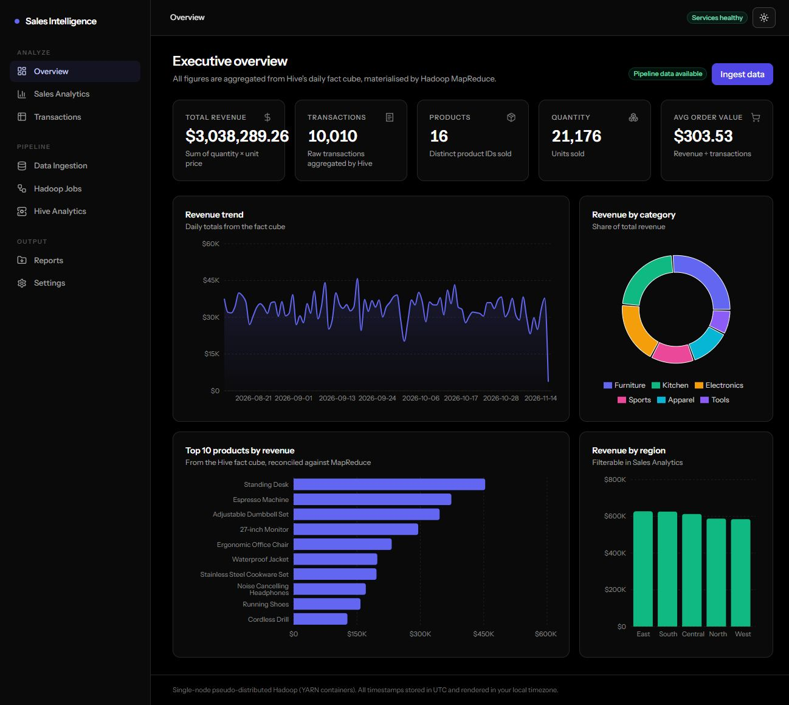

# Sales Intelligence

**Distributed sales analytics with Hadoop MapReduce, Hive, MongoDB Atlas, FastAPI and React.**



This repository contains Project 1 of a Big Data Analytics capstone: a complete,
working pipeline that ingests sales transactions, stages them to HDFS, reduces
per-product revenue with a genuine Java MapReduce job on YARN, materialises a
Hive ORC fact cube, reconciles MapReduce against Hive, and serves the results to
a React dashboard through FastAPI and MongoDB Atlas.

Every KPI, chart, table and CSV export is computed from data written by the
pipeline. There are no hardcoded dashboard numbers and no local MongoDB
fallback.

## What is included

- `sales-intelligence/` — application source, tests, datasets and documentation
- `infra/` — single-node Hadoop/Hive configuration and lifecycle scripts
- `sales-intelligence/docs/screenshots/` — real dashboard captures

## Quick start

Full setup, architecture, API and demo notes are in
[`sales-intelligence/README.md`](sales-intelligence/README.md).

```bash
cd ~/BDA-Projects
./infra/scripts/start-hadoop.sh
./infra/scripts/start-hive.sh
./sales-intelligence/scripts/start-backend.sh
./sales-intelligence/scripts/start-frontend.sh
```

Dashboard: <http://127.0.0.1:5173> · API docs: <http://127.0.0.1:8000/docs>

## Verification

- Backend: 12 unit tests passed
- Java MapReduce: 4 JUnit tests passed
- Frontend: TypeScript check and production build passed
- End-to-end: 19/19 tests passed against real Atlas, HDFS, YARN and Hive

See [`sales-intelligence/docs/TEST-RESULTS.md`](sales-intelligence/docs/TEST-RESULTS.md)
for commands, timings and evidence.

## Scope

Hadoop runs in single-node pseudo-distributed mode on WSL2. The dataset is
synthetic. Project 2 (Spark energy analytics) is intentionally not part of this
repository.
