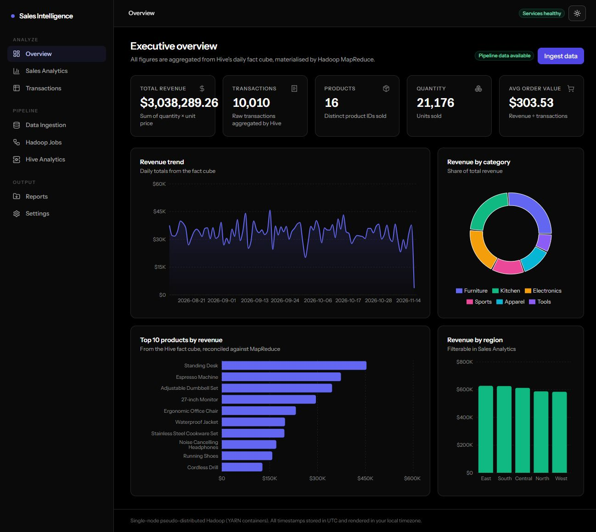
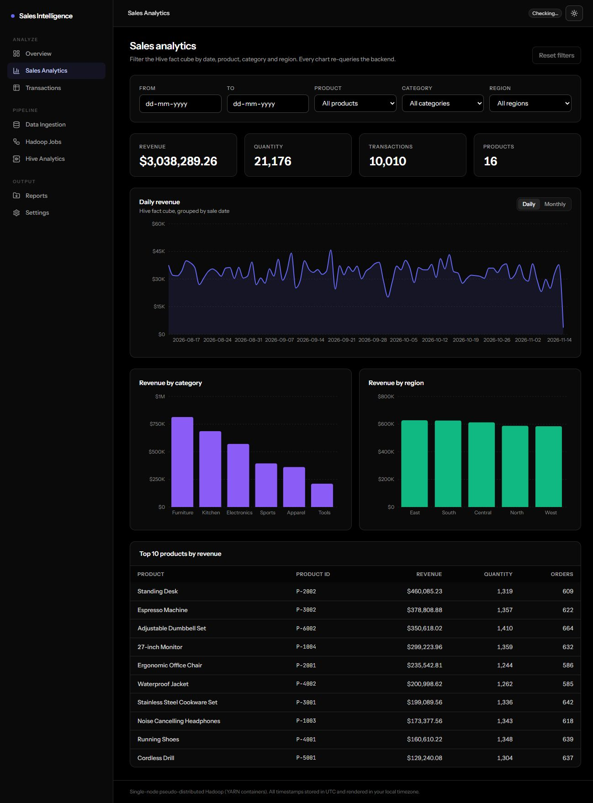
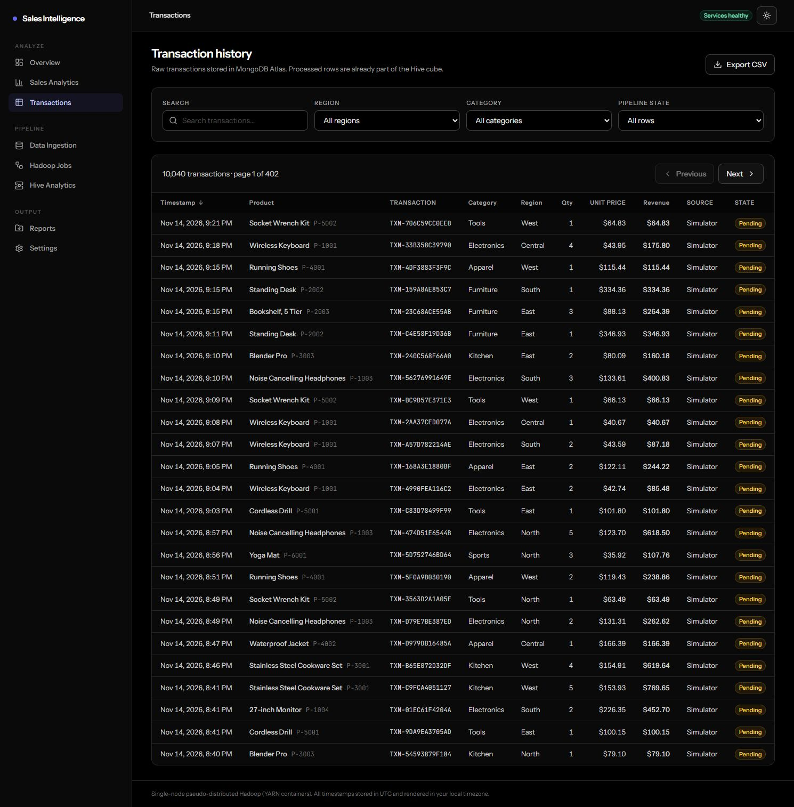
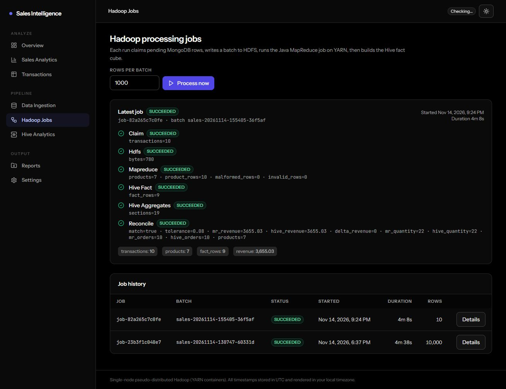
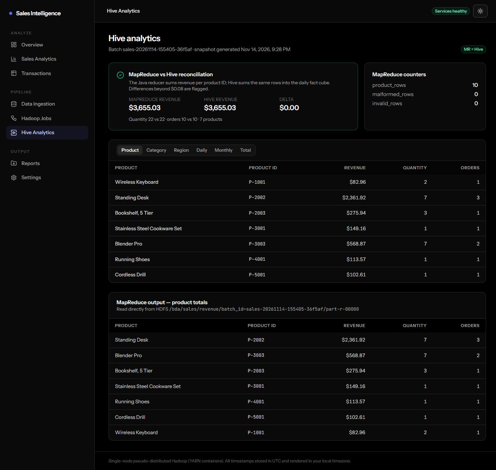
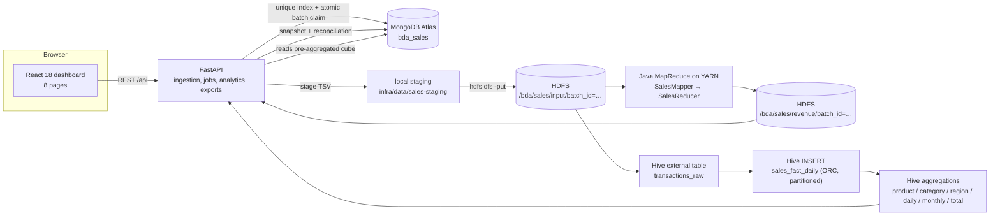

# Sales Intelligence

**A distributed sales analytics pipeline built on Hadoop MapReduce, Hive and MongoDB Atlas, with a React dashboard.**

Sales transactions are ingested through a web UI, staged to HDFS, reduced by a Java MapReduce job running on YARN, materialised into a Hive ORC fact cube, reconciled against the MapReduce totals, and served through FastAPI to a React + TypeScript dashboard.

Every KPI, chart, table and CSV export is computed from data written by this pipeline. There are no hardcoded dashboard values, and there is no local MongoDB fallback.

> **Academic scope.** This is Project 1 of a Big Data Analytics capstone. Hadoop runs in single-node pseudo-distributed mode on WSL2: real HDFS, a real YARN ResourceManager/NodeManager, and real map/reduce containers on one host — not a multi-machine cluster.

---

## Contents

- [What it demonstrates](#what-it-demonstrates)
- [Screenshots](#screenshots)
- [Architecture](#architecture)
- [Pipeline stages](#pipeline-stages)
- [Technology stack](#technology-stack)
- [Repository layout](#repository-layout)
- [Getting started](#getting-started)
- [Using the dashboard](#using-the-dashboard)
- [Data model](#data-model)
- [API](#api)
- [Reconciliation](#reconciliation)
- [Sample dataset](#sample-dataset)
- [Build and test](#build-and-test)
- [Verified run evidence](#verified-run-evidence)
- [Troubleshooting](#troubleshooting)
- [Limitations](#limitations)
- [Documentation](#documentation)

---

## What it demonstrates

- **Genuine Java MapReduce.** `SalesMapper` emits `product_id → (quantity × unit_price, quantity, 1)`; `SalesReducer` sums revenue, units and orders per product. The job is submitted with `hadoop jar` and runs in YARN containers.
- **Hive analytics at a useful grain.** Hive reads the same batch and builds an ORC fact cube at `(sale_date, product_id, category, region)`, then answers product, category, region, daily, monthly and total queries.
- **Cross-engine reconciliation.** The reducer's per-product totals are compared with Hive's cube totals. The delta, tolerance and match flag are stored and shown in the UI — never hidden.
- **Three ingestion paths.** A validated manual form, a strict CSV upload with per-row duplicate/error reporting, and a live simulator.
- **An honest dashboard.** Eight pages, server-side search/sort/pagination, filters, CSV exports, job history, Hive snapshots, loading/empty/error states, and pure-black dark mode.
- **Repeatable proof.** A 19-test end-to-end suite ingests known rows, runs the real pipeline, and checks MapReduce, Hive, reconciliation, filters and exports against independently computed values.

---

## Screenshots

| Overview | Sales analytics |
|---|---|
|  |  |

| Transactions | Hadoop jobs |
|---|---|
|  |  |

| Hive analytics and reconciliation |
|---|
|  |

The interface uses self-hosted **Instrument Sans** and **JetBrains Mono** (no CDN dependency), a neutral pure-black dark theme, and grouped navigation.

---

## Architecture



The dashboard does not query Hive on every click. The pipeline copies the fact rows into MongoDB, so filters are served by Mongo aggregation pipelines over pre-aggregated rows. Hive remains the computation engine; MongoDB is the serving layer.

---

## Pipeline stages

One job processes one batch. Every stage is recorded in the `jobs` document and rendered as a live timeline in the UI.

| # | Stage | What happens | Failure behaviour |
|---|---|---|---|
| 1 | `claim` | Select up to `batch_size` rows with `processed=false, batch_id=null`; atomically tag them with a new batch ID. Retry if the modified count differs. | Claim released |
| 2 | `hdfs` | Write a TSV staging file, upload it to `/bda/sales/input/batch_id=<id>/data.tsv`, register the Hive partition. | HDFS input and partition removed |
| 3 | `mapreduce` | Run `hadoop jar sales-mapreduce.jar edu.bda.sales.SalesDriver <in> <out>` on YARN. | HDFS output removed |
| 4 | `hive_fact` | Hive-on-MR `INSERT` into `sales_fact_daily PARTITION (batch_id=…)`. | Partition dropped |
| 5 | `hive_aggregates` | Six aggregate sections in one HiveServer2 call. | Snapshot rows removed |
| 6 | `reconcile` | Compare MapReduce and Hive revenue, quantity and orders; store delta, tolerance and match flag. | Job marked FAILED |

On success, transactions are marked `processed=true` and the batch is recorded in `processed_batches`. On failure, the job is marked `FAILED`, its claimed rows are released, and partial MR/fact/snapshot rows, the Hive partition and the HDFS output are cleaned up so the rows can be retried.

A single pipeline lock and a one-worker executor prevent concurrent runs. A second `POST /api/sales/process` returns HTTP 409 while a job is active.

---

## Technology stack

| Layer | Technology |
|---|---|
| Runtime | Java 17.0.21, Maven 3.9.16 |
| Storage / compute | Hadoop 3.4.3 — HDFS, YARN, MapReduce |
| Warehouse | Hive 4.1.0, HiveServer2, embedded Derby metastore, ORC fact tables |
| Database | MongoDB Atlas, database `bda_sales` |
| Backend | Python 3.12.3, FastAPI 0.115.14, Uvicorn (1 worker) |
| Frontend | React 18.3.1, TypeScript 5.9.3, Vite 5.4.21 |
| UI | Tailwind CSS 3.4.17, Recharts 2.15.4, React Router 6.30.1, TanStack Query 5 |
| Tooling | Node.js 24.22.2 via nvm, pytest, JUnit 4, Playwright-style HTTP E2E |

The runtime is tuned for a 7.4 GB WSL2 machine: YARN capacity 3 GB / 4 vcores, 512 MB map containers, 768 MB reduce containers, a 4 MB split size, and one heavy job at a time.

---

## Repository layout

```text
BDA-Projects/
├── infra/                           # local Hadoop/Hive installation and cluster config
│   ├── env.sh                       # JAVA_HOME, HADOOP_HOME, Hive, nvm, PATH
│   ├── conf/hadoop/                 # core-site, hdfs-site, yarn-site, mapred-site
│   ├── conf/hive/                   # hive-site.xml, hive-ddl.sql
│   ├── installed/                   # hadoop-3.4.3, hive-4.1.0, maven-3.9.16 (ignored)
│   ├── data/, logs/, run/           # HDFS data, staging, logs, pid files (ignored)
│   └── scripts/                     # start/stop/status for Hadoop and Hive
└── sales-intelligence/
    ├── backend/
    │   ├── .env.example             # copy to .env; .env is never committed
    │   ├── app/                     # config, db, ingest, csv, simulator, hadoop,
    │   │                            # hive, pipeline, analytics, export, main
    │   └── tests/                   # 12 unit tests + 19-test E2E suite
    ├── frontend/
    │   ├── public/fonts/            # self-hosted Instrument Sans + JetBrains Mono
    │   ├── src/api/                 # typed fetch client
    │   ├── src/components/          # layout, UI primitives, chart wrappers
    │   ├── src/pages/               # the eight dashboard pages
    │   └── src/lib/                 # formatting and theme
    ├── mapreduce-java/
    │   ├── pom.xml
    │   └── src/{main,test}/java/edu/bda/sales/
    │       ├── SalesMapper.java
    │       ├── SalesReducer.java
    │       ├── SalesDriver.java
    │       └── ProductRevenueWritable.java
    ├── hive/queries/                # analytical SQL used by the Hive stage
    ├── datasets/                    # 10k synthetic sample, tiny smoke fixture, expected values
    ├── scripts/                     # build, start/stop apps, dataset generator, MR smoke
    └── docs/                        # architecture, API, demo guide, test results, screenshots
```

---

## Getting started

### Prerequisites

- WSL2 Ubuntu 24.04 (or another Linux host) with enough RAM for Hadoop and Hive
- JDK 17, Hadoop 3.4.x, Hive 4.1.x, Maven 3.9+
- Python 3.12, Node.js 24 via nvm
- A MongoDB Atlas cluster and a database user with read/write access

The binaries used by this project are installed under `infra/installed/` and activated by `infra/env.sh`. Node is loaded through nvm; do not use a Windows npm binary inside WSL.

### One-time setup

```bash
cd ~/BDA-Projects

# Python environment
python3 -m venv .venv
.venv/bin/pip install -r sales-intelligence/backend/requirements.txt

# Frontend dependencies
cd sales-intelligence/frontend
npm ci
cd ../..

# MapReduce jar
source infra/env.sh
cd sales-intelligence/mapreduce-java
mvn clean package
```

### Configure Atlas

```bash
cd ~/BDA-Projects/sales-intelligence/backend
cp .env.example .env
chmod 600 .env
# edit .env and set MONGODB_PASSWORD
```

- Database: `bda_sales`; collections are created automatically.
- Network access: add the **current public IP** of the WSL environment to the Atlas access list.
- The Windows browser and WSL can egress through different addresses. If Atlas reports a TLS handshake alert, the source IP is not allowlisted — that is a network configuration issue, not an application bug.
- Avoid `0.0.0.0/0` except as a short-lived demo fallback, and rotate the database password if it has ever been exposed.

`.env` is gitignored and mode 600. The URI is built at call time, the password is URL-encoded, and no endpoint, log line or frontend bundle contains it. The backend fails loudly when Atlas is unreachable; it never falls back to a local database.

### Start and stop

```bash
cd ~/BDA-Projects

# Start: Hadoop first, then Hive, then the application
./infra/scripts/start-hadoop.sh       # HDFS, YARN, JobHistoryServer
./infra/scripts/start-hive.sh         # HiveServer2 + idempotent DDL
./sales-intelligence/scripts/start-backend.sh
./sales-intelligence/scripts/start-frontend.sh

# Check
./infra/scripts/status.sh
curl -s http://127.0.0.1:8000/api/health?deep=true | python3 -m json.tool
```

| Service | URL |
|---|---|
| Dashboard | <http://127.0.0.1:5173> |
| FastAPI docs | <http://127.0.0.1:8000/docs> |
| HDFS NameNode UI | <http://127.0.0.1:9870> |
| YARN ResourceManager UI | <http://127.0.0.1:8088> |
| MapReduce JobHistory | <http://127.0.0.1:19888> |

Stop in reverse order:

```bash
./sales-intelligence/scripts/stop-all.sh
./infra/scripts/stop-hive.sh
./infra/scripts/stop-hadoop.sh
```

The start scripts detach daemons with `setsid`, so closing the terminal does not stop them. After a WSL restart, start Hadoop → Hive → backend → frontend again.

---

## Using the dashboard

| Page | What it does |
|---|---|
| **Overview** | Five KPIs and revenue charts aggregated from the Hive fact cube. |
| **Sales Analytics** | Date, product, category and region filters; daily/monthly trend, category, region and top-10 views. |
| **Transactions** | Server-side search, sorting, filters, pagination and CSV export; processed/pending state per row. |
| **Data Ingestion** | Manual form, validated CSV upload, and a simulator with configurable interval and batch size. |
| **Hadoop Jobs** | Start a batch, follow the six-stage timeline, inspect counters and logs, and browse job history. |
| **Hive Analytics** | Latest snapshot by section, MapReduce counters, MR output and the reconciliation card. |
| **Reports** | Filtered CSV exports for transactions, products, daily, monthly, regional and category data. |
| **Settings** | Effective runtime configuration, service health and execution mode; no credentials. |

All timestamps are stored in UTC and rendered in the browser's local timezone. Dark/light theme preference is stored locally.

---

## Data model

### Transaction input

Manual JSON and CSV upload share the same fields.

| Field | Type | Rule |
|---|---|---|
| `transaction_id` | string | Optional; generated if omitted; unique |
| `product_id` | string | 1–32 characters |
| `product_name` | string | 1–120 characters |
| `category` | string | 1–60 characters |
| `quantity` | integer | 1–100000 |
| `unit_price` | number | ≥ 0; CSV allows at most 2 decimal places |
| `region` | string | 1–60 characters |
| `timestamp` | ISO-8601 or `YYYY-MM-DD` | UTC when no offset is supplied |

CSV uploads are limited to 5 MB / 50,000 rows. The schema is strict; every invalid row and duplicate is reported with a row number and reason. Rows are never silently dropped.

### MapReduce contract

Input is TSV without a header:

```text
transaction_id \t product_id \t product_name \t category \t quantity \t unit_price \t region \t timestamp_ms
```

Mapper output: key `product_id`, value `ProductRevenueWritable(product_name, quantity × unit_price, quantity, 1)`. Malformed lines and invalid values increment custom counters instead of disappearing.

Reducer output: one line per product:

```text
product_id \t product_name \t revenue \t quantity \t orders
```

Revenue is rounded per product to 2 decimals. The jar deliberately has **no `Main-Class`** in its manifest; otherwise `hadoop jar <jar> edu.bda.sales.SalesDriver <in> <out>` would treat the class name as a program argument.

### Hive tables

| Table | Storage | Grain / purpose |
|---|---|---|
| `bda_sales.transactions_raw` | External TEXTFILE, partitioned by `batch_id` | Raw batch input over `/bda/sales/input` |
| `bda_sales.sales_fact_daily` | External ORC, partitioned by `batch_id` | `(sale_date, product_id, category, region)` cube over `/bda/sales/fact` |

Aggregate sections: `product`, `category`, `region`, `daily`, `monthly`, `total`. Top-10 is the product section ordered by revenue.

### MongoDB collections (`bda_sales`)

| Collection | Key | Purpose |
|---|---|---|
| `transactions` | unique `transaction_id` | Raw input, claim state, processed flag |
| `analytics_mr_product` | `_id=batch:product` | Reducer output |
| `analytics_fact_daily` | `_id=batch:date:product:category:region` | Copy of the Hive cube for serving |
| `analytics_snapshot` | `_id=batch` | MR counters, Hive sections, reconciliation |
| `jobs` | `job_id` | Status, stages, logs, metrics |
| `pipeline_locks` | `_id=sales-pipeline` | Single-run lock |
| `processed_batches` | `_id=batch` | Completion audit and idempotency |

---

## API

Base URL: `http://127.0.0.1:8000`. Interactive schema: `/docs`, `/openapi.json`.

| Group | Endpoints |
|---|---|
| Health | `GET /api/health?deep=true`, `GET /api/mongo/status`, `GET /api/settings` |
| Ingestion | `POST /api/sales/transactions`, `GET /api/sales/transactions`, `GET /api/sales/transactions/stats`, `POST /api/sales/transactions/upload`, `GET /api/sales/transactions/template.csv`, `GET /api/sales/catalog` |
| Simulator | `POST /api/sales/simulator/start`, `POST /api/sales/simulator/stop`, `GET /api/sales/simulator/status` |
| Jobs | `POST /api/sales/process`, `GET /api/sales/processing/status`, `GET /api/sales/jobs`, `GET /api/sales/jobs/{job_id}` |
| Analytics | `GET /api/sales/analytics/overview`, `/revenue`, `/top-products`, `/regional`, `/categories`, `/trends`, `/options`, `/mr-results`, `/hive-results`, `/reconciliation` |
| Reports | `GET /api/sales/reports/export/{dataset}.csv` |

Analytics endpoints accept `date_from`, `date_to` (`YYYY-MM-DD`), `product_id`, `category` and `region`. The transactions list additionally accepts `page`, `page_size`, `search`, `processed` and `sort` (prefix `-` for descending).

Errors use a stable shape:

```json
{"detail": {"code": "PIPELINE_BUSY", "message": "job … is already running", "fields": []}}
```

Example requests:

```bash
# Add one transaction
curl -s -X POST http://127.0.0.1:8000/api/sales/transactions \
  -H 'Content-Type: application/json' \
  -d '{"transaction_id":"DEMO-1","product_id":"P-1001","product_name":"Wireless Keyboard","category":"Electronics","quantity":2,"unit_price":42.50,"region":"North","timestamp":"2026-11-11T09:30:00Z"}'

# Upload a CSV
curl -s -F "file=@sales-intelligence/datasets/sample_sales_10k.csv" \
  http://127.0.0.1:8000/api/sales/transactions/upload

# Run the pipeline
curl -s -X POST http://127.0.0.1:8000/api/sales/process \
  -H 'Content-Type: application/json' -d '{"batch_size":12000}'

# Download a report
curl -s -o products.csv \
  "http://127.0.0.1:8000/api/sales/reports/export/products.csv?category=Furniture"
```

CSV exports neutralise cells beginning with `=`, `+`, `-`, `@`, tab or carriage return to prevent formula injection.

---

## Reconciliation

```text
mr_revenue   = Σ per-product rounded reducer revenue
hive_revenue = Σ unrounded fact revenue
delta        = mr_revenue − hive_revenue
tolerance    = 0.01 × product_count + 0.01
match        = |delta| ≤ tolerance AND quantities equal AND orders equal
```

The reducer rounds per product; Hive sums unrounded fact revenue. That is why a cent-level difference is allowed, while quantity and order counts must match exactly. The Hive Analytics page displays both totals, the delta, the tolerance and a green/red verdict.

---

## Sample dataset

`datasets/sample_sales_10k.csv` is synthetic, deterministic and safe to share:

| Property | Value |
|---|---|
| Generator | `scripts/generate-dataset.py` |
| Seed | `42` (same seed reproduces the same file) |
| Rows | 10,000 |
| Date range | 2026-08-13 → 2026-11-10 |
| Products | 16 across 6 categories |
| Regions | North, South, East, West, Central |

The script writes the CSV, reads it back, aggregates it independently and cross-checks the result. `expected_sample_aggregates.json` stores the baseline:

| Metric | Expected |
|---|---|
| Transactions | 10,000 |
| Quantity | 21,154 |
| Products | 16 |
| Revenue | 3,034,634.23 |

Regenerate both files:

```bash
cd ~/BDA-Projects/sales-intelligence
../.venv/bin/python scripts/generate-dataset.py
```

These are demo-sized rows, not production volume. The project demonstrates the distributed pipeline, not raw scale; raising `ROWS` in the generator increases the work without changing the code. The live demo database may contain additional simulator or manual rows after the baseline run, so the dashboard can show totals slightly above 10,000.

---

## Build and test

```bash
cd ~/BDA-Projects/sales-intelligence
./scripts/build.sh          # Maven package + TypeScript check + Vite production build
```

Individual commands:

```bash
cd mapreduce-java && mvn test package
cd ../backend && ../../.venv/bin/pytest -q
cd ../frontend && npm run typecheck && npm run build
```

### Test status

| Suite | Command | Result |
|---|---|---|
| Backend unit | `backend$ ../../.venv/bin/pytest -q` | **12 passed, 1 skipped** (E2E module skipped by default) |
| Java MapReduce | `mapreduce-java$ mvn test` | **4 passed** (2 mapper, 2 reducer) |
| Frontend typecheck | `frontend$ npm run typecheck` | **passed** |
| Frontend build | `frontend$ npm run build` | **passed** — 708.86 kB JS (198.42 kB gzip), 28.98 kB CSS (5.41 kB gzip) |
| Dataset round-trip | `scripts/generate-dataset.py` | **passed** — 10,000 rows, revenue 3,034,634.23 |
| E2E (19 tests) | see below | **19 passed in 294.46 s** (2026-11-14) |

E2E runs against a real Atlas database, HDFS, YARN and Hive, using an isolated `bda_sales_e2e` database:

```bash
cd ~/BDA-Projects/sales-intelligence/backend
source ~/BDA-Projects/infra/env.sh
BDA_E2E=1 MONGODB_DB=bda_sales_e2e ../../.venv/bin/pytest tests/test_e2e.py -m e2e -x -s
```

The suite refuses to run against the demo database. It covers health, manual insert, duplicate rejection, CSV validation and reporting, listing/search/sort/pagination, pipeline locking, all six stages, MapReduce totals, Hive sections, reconciliation, filtered KPIs, trends, regional analytics, exports, idempotent reprocessing and the simulator. It drops its test database and Hive partition afterwards; demo data is untouched.

---

## Verified run evidence

Baseline batch: **10,000 transactions**.

| Item | Evidence |
|---|---|
| Job | `job-23b3f1c040e7`, all six stages `SUCCEEDED`, 278 s |
| MapReduce | 16 product rows, 0 malformed, 0 invalid |
| Hive fact | 5,413 fact rows in `sales_fact_daily` |
| Reconciliation | MR = Hive; delta `-0.0`; tolerance `$0.17`; 16 products |
| Revenue | `$3,034,634.23` |
| Quantity | `21,154` |
| Dashboard | Five KPIs, charts and tables loaded from the pipeline; no hardcoded values |
| YARN smoke | A tiny batch produced output byte-identical to `datasets/expected_product_revenue.tsv` |

A later 10-row batch (`job-82a265c7c0fe`) also completed all six stages in 248 s, which is why the live database contains slightly more than the 10,000-row baseline at the time of writing.

---

## Troubleshooting

| Symptom | Cause / fix |
|---|---|
| MongoDB TLS alert 80 or connection timeout | The current source IP is not in the Atlas access list. The Windows browser and WSL may use different egress IPs. |
| `MapReduce jar not found` | Run `scripts/build.sh` or `mvn package` in `mapreduce-java`. |
| Hive fails with `NoClassDefFoundError: Collections` | Hadoop 3.4 no longer ships commons-collections; `hive-site.xml` adds Hive's `commons-collections-3.2.2.jar` to `hive.aux.jars.path`. |
| HiveServer2 does not open port 10000 | Start Hadoop first, then Hive; inspect `infra/logs/hive/hiveserver2.out`. |
| Daemons die when the terminal closes | Use the provided start scripts — they detach with `setsid`. Do not start daemons bare from a transient `wsl.exe` call. |
| Hive CLI fails with JVM option errors | Put JVM flags in `HADOOP_CLIENT_OPTS`, not `HIVE_OPTS`; Hive appends `HIVE_OPTS` after the main class. |
| Frontend uses Windows npm | Source `infra/env.sh` and confirm `which node` resolves under `~/.nvm/versions/node/v24.22.2/bin`. |
| Pipeline is slow | Expected on a 7.4 GB WSL2 host. Run one heavy job at a time; Hive-on-MR stages dominate the runtime. |
| Settings page takes 30–90 s | The deep health check includes a live HiveServer2 query. Runtime configuration renders immediately; only the service card waits. |

---

## Limitations

- **Single-node pseudo-distributed Hadoop.** HDFS, YARN and map/reduce containers run on one WSL2 host. It is genuinely containerised execution, but not a multi-machine cluster.
- **Demo-sized data.** The checked-in dataset is 10,000 rows. The same code scales by increasing the generator row count; runtime grows accordingly.
- **Derby metastore.** HiveServer2 is the only writer. Suitable for a lab, not for concurrent production workloads.
- **No authentication.** The API and dashboard bind to `127.0.0.1` for a local academic demo.
- **Materialised serving layer.** Hive results are copied to MongoDB per batch. Changes made directly in Hive are not reflected until the next pipeline run.
- **Project 2 is out of scope.** The Spark energy-analytics project is intentionally not part of this repository.

All of these limitations are stated deliberately. The E2E suite and the UI both prefer a visible failure over a fabricated success.

---

## Documentation

| Document | Contents |
|---|---|
| [`docs/ARCHITECTURE.md`](docs/ARCHITECTURE.md) | Component design, data flow, storage model, reconciliation and resource tuning |
| [`docs/API.md`](docs/API.md) | Full endpoint reference, query parameters and response shapes |
| [`docs/DEMO-GUIDE.md`](docs/DEMO-GUIDE.md) | 12-minute demo script and 18 viva questions with answers |
| [`docs/TEST-RESULTS.md`](docs/TEST-RESULTS.md) | Unit, Java, build and E2E evidence with dates and timings |

---

**Project 1 — Sales Intelligence.** Built as part of a Big Data Analytics capstone. Synthetic data only; no real customer records.
