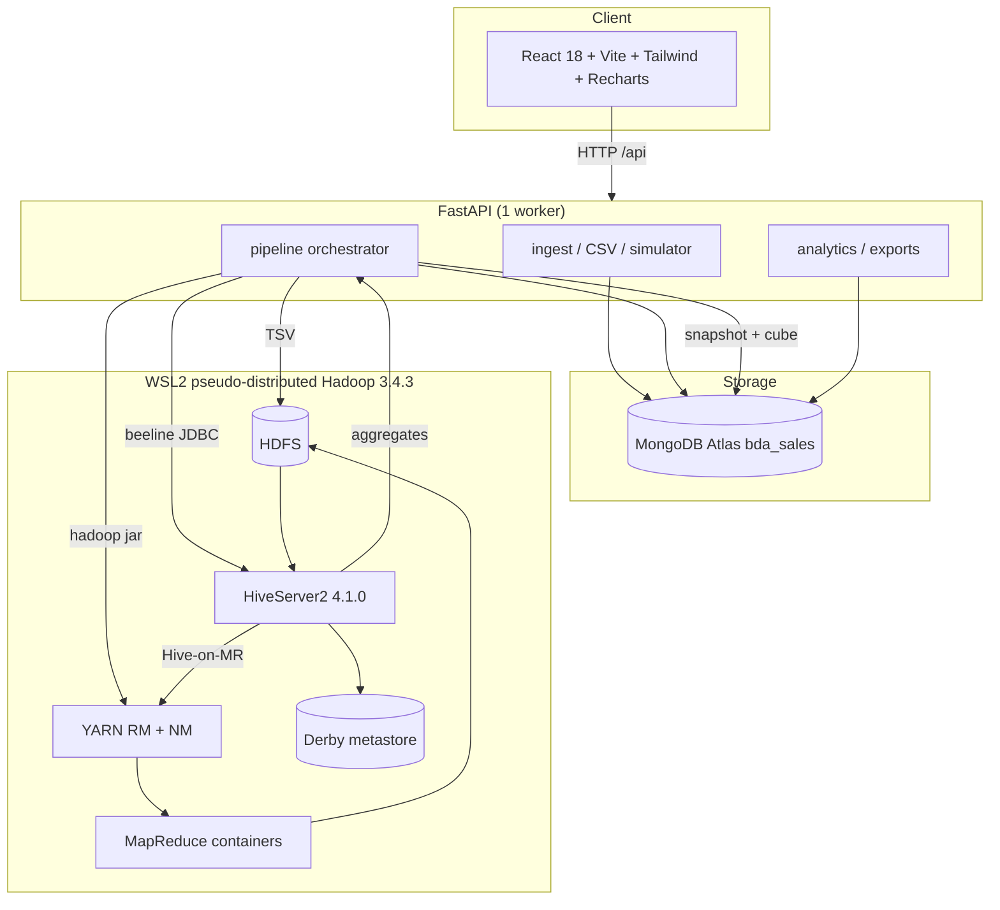

# Architecture — Sales Intelligence

## 1. Why this design

The assignment requires a real Hadoop MapReduce job on HDFS/YARN, Hive
analytics, MongoDB integration and a dashboard with no fabricated numbers. The
design therefore keeps the heavy computation in Hive/MapReduce and uses MongoDB
for storage and pre-aggregated serving.

- **MapReduce** computes per-product revenue from the raw batch. This is the
  required genuine Java job, and it is the source of truth for product totals.
- **Hive** reads the same raw batch, materialises a `(date, product, category,
  region)` cube in ORC, and answers product/category/region/daily/monthly/total
  queries. The cube makes dashboard filters fast without rerunning Hadoop.
- **MongoDB** stores raw transactions, the MR totals, the cube rows and one
  snapshot per batch. The dashboard reads pre-aggregated cube rows through
  Mongo aggregation pipelines; Python never loops over raw transactions.
- **Reconciliation** compares MR product totals with Hive totals and exposes
  the result. A disagreement is visible in the UI and stored in the snapshot.

## 2. Components



## 3. Runtime data flow

1. User adds a transaction by form, CSV or simulator. Validation happens at the
   FastAPI boundary (Pydantic), and a unique index on `transaction_id` rejects
   duplicates.
2. `POST /api/sales/process` creates a job document, acquires the single
   pipeline lock, and submits work to a one-thread executor.
3. The claim step selects pending rows and atomically tags them with a new
   `batch_id`.
4. The batch is written as TSV to `infra/data/sales-staging/<batch>/data.tsv`,
   uploaded to HDFS, and a Hive partition is registered over that directory.
5. `hadoop jar` runs `SalesDriver` on YARN with one reducer and a 4 MB split
   size (so the demo can show multiple map tasks on larger batches).
6. The reducer output is read back from HDFS and stored in
   `analytics_mr_product`.
7. Hive inserts the batch into `sales_fact_daily`; the fact rows are copied to
   `analytics_fact_daily` so dashboard reads do not touch Hive.
8. Hive computes six aggregate sections; a snapshot with MR counters and the
   reconciliation is stored in `analytics_snapshot`.
9. Claimed transactions are marked processed and the batch is recorded in
   `processed_batches`.

Failure at any stage: the job is marked FAILED, the claim is released
(`batch_id=null`), partial MR/fact/snapshot rows for that batch are deleted, and
the Hive partition and HDFS output are dropped. The rows become retryable.

## 4. MapReduce contract

Input (TSV, no header):

```text
transaction_id \t product_id \t product_name \t category \t quantity \t unit_price \t region \t timestamp_ms
```

Mapper:

- key: `product_id`
- value: `ProductRevenueWritable(product_name, quantity × unit_price, quantity, 1)`
- malformed lines and invalid quantity/price are counted, not silently dropped
  (`SALES_JOB_COUNTER` lines expose the counters).

Reducer:

- sums revenue, quantity and order count per product
- rounds the product revenue to 2 decimals
- emits `product_id \t product_name \t revenue \t quantity \t orders`

Driver:

- parses Hadoop generic options itself, validates input/output arguments
- fails if the output directory exists
- reduces task count configurable with `-D mapreduce.job.reduces=N`
- the jar has no `Main-Class` so `hadoop jar <jar> <class> <args>` behaves
  correctly.

## 5. Hive model

`hive-ddl.sql` defines:

```sql
transactions_raw (
  transaction_id, product_id, product_name, category,
  quantity, unit_price, region, timestamp_ms
) PARTITIONED BY (batch_id) STORED AS TEXTFILE
LOCATION '/bda/sales/input';

sales_fact_daily (
  sale_date, product_id, product_name, category, region,
  revenue, quantity, orders
) PARTITIONED BY (batch_id) STORED AS ORC
LOCATION '/bda/sales/fact';
```

Fact build (`hive.py`):

```sql
INSERT INTO TABLE sales_fact_daily PARTITION (batch_id='…')
SELECT from_unixtime(CAST(timestamp_ms / 1000 AS BIGINT), 'yyyy-MM-dd'),
       product_id, max(product_name), category, region,
       sum(quantity * unit_price), sum(quantity), count(1)
FROM transactions_raw
WHERE batch_id = '…'
GROUP BY 1, 2, 4, 5;
```

Aggregate sections: `product`, `category`, `region`, `daily`, `monthly`,
`total`. Top-10 is the product section sorted by revenue (dashboard slice); the
underlying product query is in `hive/queries/`.

## 6. Storage model (MongoDB Atlas, `bda_sales`)

| Collection | Key | Purpose |
|---|---|---|
| `transactions` | unique `transaction_id` | raw input, claim state, processed flag |
| `analytics_mr_product` | `_id=batch:product` | reducer output |
| `analytics_fact_daily` | `_id=batch:date:product:category:region` | Hive cube copy |
| `analytics_snapshot` | `_id=batch` | MR counters, Hive sections, reconciliation |
| `jobs` | `job_id` | status, stages, logs, metrics |
| `pipeline_locks` | `_id=sales-pipeline` | single-run lock |
| `processed_batches` | `_id=batch` | completion audit and idempotency |

Indexes: unique transaction ID, `(processed, batch_id)`, timestamp, product,
region, cube `(sale_date, region, product_id)`, batch IDs, job start time.

## 7. Reconciliation

```text
mr_revenue   = Σ per-product rounded reducer revenue
hive_revenue = Σ unrounded fact revenue
delta        = mr_revenue − hive_revenue
tolerance    = 0.01 × product_count + 0.01
match        = |delta| ≤ tolerance AND quantities equal AND orders equal
```

The snapshot stores both values and the tolerance. The Hive Analytics page shows
a green match or a red mismatch with the delta; it never hides a discrepancy.

## 8. Idempotency and recovery

- Atomic claim prevents double processing.
- Unique transaction index prevents duplicate ingestion.
- Deterministic analytics IDs plus upsert prevent duplicate analytics rows.
- One batch = one Hive partition = one HDFS output directory.
- Lock + executor prevent concurrent pipelines; HTTP 409 exposes the active job.
- Startup recovery fails orphaned RUNNING jobs and releases their rows.
- Failed batches are cleaned up and retryable.

## 9. Resource tuning (WSL2, 7.4 GB)

| Component | Setting |
|---|---|
| NameNode / DataNode | 256 MB / 384 MB heap |
| ResourceManager / NodeManager | 384 MB each |
| YARN capacity | 3072 MB, 4 vcores |
| Map / Reduce container | 512 MB / 768 MB |
| MR split size | 4 MB |
| HiveServer2 | 768 MB heap |
| FastAPI | 1 uvicorn worker |
| Heavy jobs | one at a time; Project 2 not run simultaneously |

## 10. Honest execution model

Pseudodistributed: all daemons run on one WSL2 host. Map and reduce tasks are
separate YARN containers/JVMs, so execution is distributed across containers,
but not across machines. Scaling out would require adding DataNode/NodeManager
hosts and updating the Hadoop configuration; no multi-node claims are made.

## 11. Inputs and outputs

| Stage | Input | Output |
|---|---|---|
| Ingestion | manual JSON / CSV / simulator | `transactions` docs |
| Claim | pending transactions | batch-tagged docs |
| HDFS | staging TSV | `/bda/sales/input/batch_id=…/data.tsv` |
| MapReduce | HDFS TSV | `/bda/sales/revenue/batch_id=…/part-r-00000` + counters |
| Hive fact | `transactions_raw` partition | ORC `sales_fact_daily` partition |
| Hive aggregates | fact partition | six aggregate sections |
| Snapshot | MR rows + Hive sections | `analytics_snapshot`, reconciliation |
| API | Mongo cube / snapshot | JSON KPIs, charts, tables, CSV |
